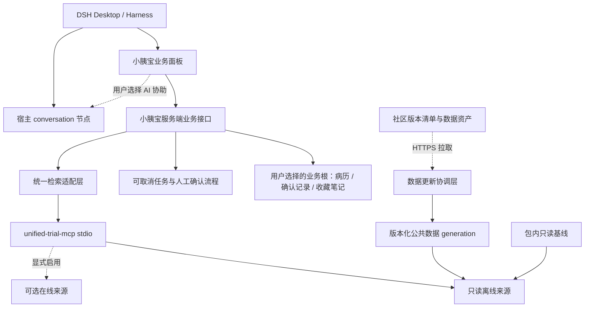

# 小胰宝工作台 · 集成、数据与交付设计

日期：2026-10-13 · 状态：**设计建议，非已实现能力清单**。

Agent 查询与工作台结果回写的交接规则见 [AGENT-QUERY-DESIGN.md](./AGENT-QUERY-DESIGN.md)。
DSH Desktop 工作台会话与分栏适配基线见[DESKTOP-ADAPTATION-1.2.2.md](./DESKTOP-ADAPTATION-1.2.2.md)；该文档逐项区分已存在的客户端调用、需要增加的患者—会话映射和目标 Desktop 实机验收项。

产品范围以 [SPEC-v0.3.md](./SPEC-v0.3.md)第 3 节为准，页面以 [UI-DESIGN.md](./UI-DESIGN.md)为准。本文件记录已只读核实的资产、待实现的适配与交付门槛。当前没有开发业务功能、启动上游服务、运行安装、构建工作台包或执行业务验收。

## 1. 总体结构与责任边界



DSH 是唯一宿主与 Agent runtime。工作台不修改 Electron main/preload、宿主模式切换、私有 DOM或全局 slot规则。业务前端通过小胰宝命名空间接口访问本机服务，不能持有文件系统/进程特权或模型密钥。宿主公开接缝不足时先记录具体能力缺口和可行降级，不将“可扩展”写成“已存在 API”。

离线表单检索直接调用本机业务服务，再调用统一检索服务，不需要先让模型理解问题。技能用于规范 Agent 如何调用工具和解释证据；它不是离线查询必须经过的一层。

## 2. 本地资产核实记录

核实日期：2026-10-13。以下仅为读取清单、源码和数据结构的结果，**不代表编译、查询或安装已通过**。本地其他项目保持只读；未复制未提交内容到新包。

### 2.1 代码与服务

| 资产 | 已核实事实 | 集成结论 |
|---|---|---|
| `unified_search_trials` | 包名 `unified-trial-mcp`，v0.3.1，Node `>=22.13.0`，依赖 MCP SDK，stdio入口；对应 `opencare-skillhub/unified-trial-search-mcp-service` | 推荐唯一检索入口，冻结版本与依赖；不能仅把源码目录打进工作台 |
| 六个 adapters | `ictrp`、`ctv`、`chictr_online`、`chictr_pancreatic_archive`、`chinadrugtrials`、`xyb_chinadrugtrials_archive` | 六个可注册来源不等于六个默认可用来源；按来源选择与就绪状态调用 |
| ChiCTR 离线 adapter | 源码惰性加载 `node:sqlite`、只读本地SQLite | 需核实实际子进程Node/SQLite/FTS能力，不能按开发机Node版本推断宿主内可用 |
| XYB归档 adapter | 在配置根**下一层**寻找含 `summary.json` 的包目录；读取 `results` 与对应JSON，保留缺失/不完整警告 | 适合新版 `output/胰腺癌` 层级，平铺备份需独立转换 |
| CTV adapter | 通过 `process.execPath` 启动 `ctv-mcp-server` 已构建入口，调用 `search_studies`；仅有数据库不足以查询 | 要交付服务代码与依赖并验证实际读取的DB；见2.4 |
| `ctv-mcp-server` 本地源码 | v0.1.1，Node `>=20`，依赖原生 `better-sqlite3 ^12.8.0`；配置读 `CTV_DB_PATH` 或 `CTV_DATA_DIR` | 不可标成纯JS或仅数据依赖；按OS/架构/运行时ABI打包 |
| `ictrp-mcp-service` | Python主项目要求 `>=3.10`；npm入口v0.2.0要求Node `>=20`，有sidecar与安装脚本 | 作为后续可选来源；npm包不自动消除Python/系统依赖，需要独立运行闭包核实 |
| `chictr-mcp` | 在线查询与Playwright相关依赖，可选FlareSolverr/LLM路径；工作树有既有变更 | 不默认随离线MVP启动；不能为集成清理或覆盖其WIP |
| `Downloads/data` | 当前为空 | 不能作为现成数据bundle或验收样本 |

关键源码依据：`unified_search_trials/src/adapters/index.ts`、`xyb-archive.ts`、`chictr-pancreatic.ts`、`ctv.ts`、`src/cli/bootstrap.ts`、`src/cli/corpus.ts`；`ctv-mcp-server/src/config.ts`、`src/store/repository.ts`。这里的路径用于本机调查定位，生产配置必须在安装后生成，不包含机器绝对路径。

### 2.2 用户补充的 CDE 完整目录

核实位置：`xyb-chinadrugtrials-data/output/胰腺癌/`。

| 检查项 | 只读结果 | 意义 |
|---|---|---|
| 总文件与大小 | 712个文件，111,961,756 bytes，约112.0MB未压缩 | 包含源HTML、JSON、Word等；与release压缩大小不能直接比较 |
| `summary.json` | `results`139项，139个不同登记号；声明total_records/total_extracted/success_count均139 | 有adapter需要的包清单 |
| 明细JSON | `json/`139份，均能JSON解析；139个summary登记号均有对应明细 | 只证明结构完整与可定位，不证明字段医疗含义或全部来源记录完整 |
| 主要顶层字段 | 139份均有非空reg_no、scrape_time、details、sections、full_text、content_hash | 满足候选归档的基本形状；明细字段仍需规范化与查询验证 |
| 清单路径 | json_path/raw_path均139条相对路径；word_path13条，126条为空 | 迁移需保留路径语义；Word缺失不能导致整条记录失效 |
| 抓取时间 | 明细从2026-08-14至2026-09-29；summary时间2026-09-29 | 混合快照，应显示范围与来源日期，不宣传为同一天全量刷新 |
| 增量计数 | summary中json_count=13、word_count=13、skip_count=126 | 不应据此误判全量JSON只有13；导入检查以清单+实际文件核对 |
| `json_backfill_summary.json` | 历史回填created=20、failed=0、total_raw_files=20 | 只描述一次回填作业，不是当前139条全量清单；其中原开发机路径不应进入交付包 |

明细中存在以中文标签、表格行内容作键的结构，能够解析JSON不等于每个中心/入排字段都被正确结构化。归档保留原始证据，前端对缺失与未规范化字段明确标示；不得编造中心数量或自动补全联系信息。

**推荐导入形状：** 把含“胰腺癌”子目录的父目录作为 `xybArchive`。打包后的结构应为 `xyb_cde_pancreatic/胰腺癌/summary.json` 与同层 `json/`、`raw/`；不能把参数指向 `胰腺癌/` 本身，也不能把其内容平铺到语料根。

现有adapter尝试多个合理锚点并处理路径前缀 `output/`。集成时仍须使用“打包→解压到新路径→真实search/detail/evidence”验收，不能只凭路径算法阅读判断所有引用可用。

### 2.3 旧平铺备份与 release 清单

`xyb-cde-archive-backup-20261005`：140个文件，7,924,497 bytes；包含139条平铺JSON及`index.json`，没有`summary.json`。它可作为恢复/比对输入，**不能直接配置给目前 `XybArchiveAdapter` 并宣称就绪**。若要支持，应设计显式转换器，校验登记号、原字段与来源日期，生成新的标准包；转换不能悄悄补造不存在的HTML/Word证据。

现有 `corpora/manifest.json` 固定三份2026-10-05 release资产：

| corpusId | 压缩bytes | 现有清单描述与挂载形状 |
|---|---:|---|
| `chictr_pancreatic` | 25,381,264 | ChiCTR胰腺癌SQLite；挂载具体 `chictr_pancreatic.db` |
| `xyb_cde_pancreatic` | 11,032,155 | CDE社区归档；挂载包含包子目录的语料根 |
| `ctv_index` | 23,964,370 | CTV SQLite索引；挂载具体 `ctv.db`，另需CTV服务 |
| **合计** | **60,377,789** | 约60.4MB十进制压缩；非最终工作台安装体积 |

数据生命周期文档对release描述为ChiCTR468条、CDE710文件、CTV1434 studies。这些是上游发布说明，**本轮未下载并逐条验证release**；不要把本地712文件与release710文件混成同一验收结果。代码、Node附件、native库、解压后数据及回滚副本会继续增加体积。

每个数据资产保留上游来源、抓取/覆盖描述、分发依据与license/notice信息；MIT代码许可证不能自动替代数据的分发说明。现有manifest的`basis`和note是维护者声明，应随资产保留，不由工作台推导新的授权结论。

### 2.4 CTV 的明确集成门槛

目前 `CtvAdapter.search()` 启动上游进程时没有显式传递 `ctvDatabase` 对应的 `CTV_DB_PATH`；上游实际配置默认读取 `~/.ctv-mcp/ctv.db`。因此存在“status检查了配置的数据库，search实际读取另一位置”的集成风险。

待实现措施：为子进程显式传入受验证的数据库位置（环境变量或上游受支持参数），同时指定数据目录与只读模式/查询能力边界；用仅存在于目标测试DB的标记记录验证search/detail实际命中该DB。不能靠开发机已有默认DB掩盖问题。另须验证`better-sqlite3`对所选Node/Electron ABI的兼容、离线查询不自动发网络请求，以及更新时关闭数据库句柄。

CTV只有在这些门槛通过后才进入“开箱即用已验证来源”清单。设计目标仍是三份离线语料；若任一来源无法完成验证，交付必须明确缩减来源的影响并请用户决定，不把失败来源隐藏后仍宣称三源就绪。

## 3. 四层打包与推荐运行拓扑

| 层 | 打包内容 | 不包含/不依赖 |
|---|---|---|
| 工作台插件 | 服务端入口、客户端单文件、schema、业务资源、Cordis patch、版本与notice | 不复制宿主React/Cordis/Harness单例；不写宿主源码 |
| 检索运行层 | 固定版本unified服务、MCP SDK、选定上游服务、必要运行附件 | 不依赖开发仓库node_modules、全局PATH或用户手工npm install |
| 技能层 | 小胰宝检索/证据说明技能、工具调用说明、必要脚本及版本 | 复制SKILL.md不等于已被Harness发现；不能靠提示词替代真正工具注册 |
| 数据层 | 已校验只读基线、manifest、来源说明、可更新的generation | 不含病历、患者收藏、模型凭据、采集日志和开发机缓存 |

推荐默认：按目标平台交付一个工作台安装包及受管理运行附件，用户只操作一次安装入口。平台附件可以在构建时形成，但宣称离线可用的交付必须已包含所需附件，不能第一次打开时临时联网安装编译器、Python、浏览器或Node。

当前DSH宿主使用随Electron运行的Node能力，**并不携带独立Node二进制**；不能假定`node`存在，也不能把`process.execPath`在任意进程里都当普通node。两种实现需做一次原型比较再冻结：

1. 若目标宿主提供可供插件使用的受支持子进程启动路径，且其Node/SQLite/native ABI均满足，复用该能力；插件不复制或猜测宿主内部shim路径。
2. 否则在工作台附件中提供明确版本、匹配平台架构的私有Node及CTV依赖，按绝对安装位置启动；不篡改全局PATH，也不把Node写入用户shell配置。

建议优先采用最少依赖的离线链路（XYB JSON、ChiCTR SQLite）完成接口集成，同时解决CTV原生依赖；不能据此把已讨论的三源目标默默缩成一源。ICTRP/Python和在线ChiCTR浏览器依赖按后续范围独立启用。

### 3.1 进程与生命周期

- 小胰宝服务端持有统一检索进程，stdio仅走结构化MCP；stdout不得夹杂日志，诊断写stderr并限量。
- 采用惰性启动与就绪检查；不是工作台打开就并行拉起所有上游服务。来源请求按需要启动，统一并发/超时/取消。
- 如果已有服务每次请求启动子进程，先适配其现状并测开销，不擅自假设已有长驻池。后续池化必须处理句柄、版本和卸载清理。
- 服务启动故障仅影响相应模块，病历表单与其他工作台应可继续使用。错误中保留阶段、缺失依赖和可操作原因，不输出患者正文。
- 卸载/重载清理effect、监听器、timer、子进程和锁；运行中任务先标记中断。切换宿主模式不等于卸载，不自动杀掉工作台后台任务。

### 3.2 平台和运行依赖矩阵

全部为**待验证**，不是支持承诺。

| 项目 | macOS arm64 | macOS x64 | Windows x64 | Windows arm64 / Linux |
|---|---|---|---|---|
| 宿主工作台注册/公开API | 在目标安装版本验收 | 独立验收 | 独立验收 | 先核对Desktop是否支持，不推定 |
| unified Node>=22.13 | 宿主能力或匹配私有运行时 | 同左，不能复用arm64附件 | 可执行路径与带空格目录 | 未列入首个交付基线 |
| `node:sqlite`与FTS | 实际子进程探测 | 同左 | 同左，文件锁行为另验 | 未验证 |
| CTV `better-sqlite3` | 对应架构/ABI产物 | 对应架构/ABI产物 | DLL/native addon与ABI | 未验证 |
| 解压/更新 | 同卷rename、权限与只读包 | 同左 | 句柄关闭、杀毒占用与重试 | 未验证 |
| 在线ICTRP | Python sidecar闭包另验 | 同左 | 解释器/依赖/路径另验 | 可选，不进入离线依赖 |
| 在线ChiCTR | 浏览器/FlareSolverr配置另验 | 同左 | 同左 | 可选，不默认启动 |
| 报告OCR/PDF导出 | 选定实现后查字体/二进制 | 同左 | 同左 | 未验证 |

现有`fetch-corpus`使用系统`tar`子进程。macOS/Windows常见可用不等于所有目标环境可用；推荐工作台采用已审阅的受限解压实现，或把已验证的解压工具列入平台附件。必须防止路径逃逸、软链接逃逸、解压体积超限，并设超时。

## 4. DSH 包契约与宿主接入

### 4.1 身份与入口

| 标识 | 本稿建议 |
|---|---|
| 仓库URL与工作台身份 | URL已明确；`xyb-openharness-dsh-plugins/xyb-workbench` |
| npm包名 | 建议`@xyb-openharness-dsh-plugins/xyb-workbench`，实现前核实命名/作用域；本地安装不要求先公开发布 |
| 插件条目ID | 建议`xyb-workbench-main`，避免与其他插件冲突 |
| 服务端API前缀 | 建议`/api/xyb-workbench/`，属于本插件拟建接口，不是宿主现有API |
| 客户端模块ID | 与最终npm包名完全一致 |

必须提供完整SemVer、服务端main/exports["."]、`dsh.bundle.patch`、`dsh.client.platform="web"`、`dsh.client.inject`包含`dsh-desktop-workbenches`、exports["./client"]指向已经构建的单文件。只按实际使用补充其他客户端模块；`dsh.client.inject`决定客户端模块顺序，Cordis `inject`描述服务注入，两者不是同一契约。

宿主`@deepseek-ai/*`依赖建议放peer，范围覆盖实际预发布分支；业务普通依赖明确随包可解析。服务端Config必须是Schemastery schema，不能导出普通对象；Schemastery为实际运行依赖。不要依赖未文档化的`dsh.client.inline`等字段。

`cordis.patch.yml`为YAML数组，自己的insert条目name写npm包名；不覆盖宿主/其他插件条目。`root: !!js dshHomePath(...)`只表达应用配置路径建议，不能自动作为患者业务根；具体目录语义遵循SPEC。patch为空时应为`[]`，但实际工作台需有自己的服务端插入行。

客户端通过`window.__ModuleLoader__.load({ id, factory })`注册，factory仅require共享基线、已加载模块与明确external。使用`ctx.desktopWorkbenches.register({ title, repository, customFrame: true, ... }, BusinessPanel)`，新包不填旧`id`。注销函数交给`ctx.effect`管理；一个包只注册一个工作台。

### 4.2 已知API与待核对接缝

| 能力 | 文档确认状态 | 本项目处理 |
|---|---|---|
| `desktopWorkbenches.register`及customFrame | 官网有说明 | 按目标安装版本核对可选props和生命周期 |
| 宿主提供的`conversation`节点 | 官网有说明 | 复用节点，业务区内按需显示；不复制聊天UI |
| `desktopWorkbenchOwnership.read()` | 官网列出的服务端只读能力 | 检查owner时使用；不是任意设置会话归属的写API |
| 目录选择、创建/恢复会话、草稿与workspace | 官网规定行为，但本稿未核实每个调用签名 | 在适配层封装实际公开方法，开工先对照目标版源码与真实UI |
| 技能注册、MCP与preset装配 | 需要核实目标Harness实际扩展机制 | 明确注册与卸载；未确认机制前不写“随包自动可用” |
| Node子进程启动/平台附件 | 插件需要能力，宿主具体公开接缝未确认 | 不使用猜测的私有IPC；必要时用插件自带运行附件 |

### 4.3 技能、工具和会话装配

拟提供“小胰宝试验资料检索”技能：说明何时使用离线/在线、怎样调用统一工具、如何保留来源和截止日期、部分失败与零结果如何表达、禁止把检索结果称为入组判断。必要时另有“病历资料核对”技能，规则是提取候选、引用证据、等待人工确认。

实现清单：包内技能资源→插件激活时显式注册到受支持技能/preset机制→工具注册到受支持MCP客户端→仅向小胰宝相关会话提供→卸载注销。每个箭头须有实际加载证据；把`skills/foo/SKILL.md`复制到npm包并不自动完成任何后续步骤。不得写入用户全局技能目录或篡改其他会话preset。

病历提取如果只用专用本机业务任务，可不创建聊天会话；若调用宿主Agent，就必须通过已核验会话归属和明确的任务动作。具体调用选择作为实现决策记录，不能以“模拟用户发消息”的隐藏UI操作替代。

## 5. 建议的业务接口与任务契约

本节是**小胰宝自有接口建议**，不表示DSH已经存在这些方法或URL。最终传输可采用目标宿主已支持的HTTP/RPC方式；服务端鉴权、来源校验与错误封装须接入现有connection约束，不能开放无认证公共端口。

### 5.1 请求形状

```ts
type Scope = {
  storeId?: string
  patientId?: string
  sessionId?: string
  taskKind?: 'report-review' | 'summary' | 'trial-search'
}
type Request<T> = {
  requestId: string
  idempotencyKey?: string
  expectedRevision?: number
  scope: Scope
  payload: T
}
type Failure = {
  code: string
  stage: string
  message: string
  retryable: boolean
  fieldErrors?: Record<string, string>
}
type Result<T> =
  | { ok: true; requestId: string; data: T; revision?: number }
  | { ok: false; requestId: string; error: Failure }
```

服务端不信任scope中的patientId与路径：确认store已选择、患者属于store、document属于patient，涉及Agent时再确认宿主owner与业务SessionBinding一致。文件以受控token/ID和相对路径引用，不允许客户端传入任意绝对路径读写。路径解析检查规范化路径、符号链接与父目录边界。

| 建议操作 | 输入/结果重点 |
|---|---|
| `storage.inspect / bind` | 宿主目录选择结果→验证可写/已有store/schema→绑定；取消不调用bind |
| `patients.list / create / update / archive` | 昵称等最少字段；创建幂等，更新revision |
| `documents.previewImport / import` | 选择结果、支持类型、hash、去重预览；import返回jobId |
| `extractions.start` | 固定patient/document/input hash、提取方式、用户发起的线上处理决定→jobId |
| `reviews.get / confirm` | 候选、证据、修改值、expectedRevision；确认事务生成正式fact/observation |
| `observations.query` | 患者、指标、单位组、日期范围→确认记录及来源 |
| `summaries.create / revise / export` | 模板版本、纳入记录revision、用户正文；导出返回文件ID/结果状态 |
| `trials.search` | queryId、来源集合、词/筛选、分页、generation策略→规范化结果+来源状态 |
| `trials.detail / evidence` | sourceId+recordId+generation，检查证据根范围 |
| `bookmarks.save / notes.update` | patientId、snapshot、稳定键、revision；不得由公共更新服务写入 |
| `sources.status / datasets.check / update / rollback` | 只针对公共数据；返回阶段与可重试错误 |
| `jobs.get / cancel / retry` | 按jobId作用域访问；重试沿用幂等输入，必要时生成新run而非重复提交 |

### 5.2 查询结果形状

```ts
type TrialSearchResult = {
  queryId: string
  records: Array<{
    trialKey: string
    members: Array<{ sourceId: string; recordId: string; generation: string }>
    title: string
    fieldEvidence: Record<string, string[]>
    conflicts: string[]
  }>
  sources: Array<{
    sourceId: string
    status: 'success' | 'partial' | 'failed' | 'needs-setup' | 'not-enabled'
    generation?: string
    capturedFrom?: string
    capturedTo?: string
    coverage: string
    zeroResultMeaning: string
    returned: number
    total?: number
    truncated: boolean
    appliedFilters: string[]
    unsupportedFilters: string[]
    warnings: string[]
  }>
  nextCursor?: string
}
```

既有MCP响应应经过适配层而非假定与上面一致；保留`NEEDS_SETUP`、错误reasonCode、freshness、coverage和incompleteness等已有语义。查询期间固定generation；分页游标包含查询hash、来源版本与规则版本，防止跨版本页码混用。改变筛选取消/作废旧请求，不让旧响应覆盖新结果。

### 5.3 状态机、幂等与取消

任务状态建议：`queued → running → awaiting-review / succeeded / failed / cancelled`，进程中断为`interrupted`。每个阶段保存检查点；只有confirmed写入事务才生成正式观察值。所有长任务有时间上限与AbortSignal，子进程超时后先终止、再在有限宽限期清理，不无限等待。

| 操作 | 幂等键/事务范围 |
|---|---|
| 导入文件 | storeId+patientId+contentHash；不同患者相同文件可分别关联，不跨患者静默共享权限 |
| 提取 | documentHash+extractorVersion+promptVersion+选项；重复运行保留run版本，不叠加已确认指标 |
| 人工确认 | candidateId+expectedRevision+confirmOperationId；候选状态与正式记录同事务提交 |
| 收藏 | patientId+stableTrialKey；重复点击返回已有收藏，可追加新快照，不复制笔记 |
| 数据安装 | corpusId+version+sha256；同一target有单写入锁 |
| 导出 | summaryId+revision+format；明确覆盖/另存规则，不破坏前版 |

取消在提交前中止后续写入并清理本任务暂存；提交后取消返回“已完成，不能取消”，用户如需撤销执行显式业务动作。应用重启后不自动重发模型请求，先标中断让用户选择重试。患者/页面切换只影响视图，后台结果写入任务创建时的患者与文档作用域；服务端不读取前端“当前患者”变量决定归属。

## 6. 数据初始化与联网更新

### 6.1 现有能力与需新增部分

已存在的`fetch-corpus`：读取**包内**`corpora/manifest.json`，下载固定资产，检查长度和SHA256，暂存解压，验证必需文件/SQLite表，原子替换。`bootstrap --apply`主要对未配置的可公开语料执行安装并记录路径；对已有路径检查可读性；不自动安装缺失的CTV等上游代码。

未发现现有远端最新manifest发现、定期调度、版本兼容筛选、查询generation钉住或用户级回滚保留机制。**现有bootstrap不是自动更新系统。**工作台需要新增更新协调层，复用校验思路或受支持的函数，不简单定时运行bootstrap后宣称同步完成。

### 6.2 首次离线初始化

安装包提供不可变的种子数据与清单。初次打开按安装位置读取基线，不修改包目录，不依赖患者业务根，也不创建患者。对于必须以可写方式打开数据库的上游服务，应先实现只读查询或使用明确获准的内部应用缓存副本；不能在未选路径时默默使用`~/.ctv-mcp`等默认路径。若目标宿主未提供明确内部缓存目录契约，提供数据位置选择，选择前仍应保留可直接只读的来源；承诺“三源无配置首启”前必须解决这一点。

在首次就绪检测中检查：运行时存在、各入口可执行、所需SQLite表/schema存在、计数合理、来源日期可读取、对固定非敏感查询能够搜索并打开详情。正式产品启动可做轻量健康检查，重型校验在安装/数据切换时执行，避免每次启动阻塞全量扫描。

用户选择业务根与公共试验基线无依赖。首次浏览公共试验不写患者资料；首次收藏才进入患者与资料位置流程。没有模型Key时不显示全页“请配置模型”拦截。

### 6.3 远端版本发现（拟建协议）

由社区发布稳定的**数据渠道清单**，例如专门release中的`channel.json`或已确定的HTTPS静态入口；具体URL在发布者确认后写入配置，本文不虚构一个已经存在的地址。清单与包内固定版本manifest分工如下：

- 包内manifest：可离线读取的已知基线、hash与必要兼容信息。
- 远端channel：有哪些可用版本、哪些版本被撤回、各版本不可变manifest地址/hash、最低适配器版本。
- 版本manifest：每个资产的固定URL、bytes、SHA256、schemaVersion、来源覆盖与抓取范围、notice。

建议字段：`channelSchemaVersion`、`publishedAt`、`sequence`、`corpora[]`；单语料含`corpusId/version/dataSchemaVersion/minAdapterVersion/assets/platform?`、`captureRange`、`coverage`、`recordCount`、`licenseNotice`、`revoked`。旧manifest缺字段不能由客户端猜成已满足兼容，需维护者补充或显式兼容转换。

采用固定可信HTTPS来源与下载域范围；hash校验防损坏但不等于保证发布者内容正确。对未知schema、超大清单、异常版本倒退、被撤回版本明确拒绝自动切换。镜像保持原资产hash，不通过关闭校验解决下载失败。

### 6.4 调度默认（建议）

首次启动后延迟检查；以后最多每日一次自动检查，网络恢复或应用唤醒后按上次时间去重，不创建多个并发调度器。用户可关闭自动更新或点击“检查更新”。启动立即使用本地数据，检查不阻塞首屏。

推荐请求超时：清单15秒、单资产120秒；网络失败最多3次指数退避并加抖动。无网后延后下次检查，不无限重试。请求仅含版本、ETag/缓存条件等必要公共元数据，不带患者与检索词。版本变化按语料下载，避免每次全量三份；首期不要求增量差分数据格式。

“已检查，无新版”“检查失败，继续本地版”“新版已下载，待切换”“更新完成”必须分别展示。数据发布时间不是最后检查时间；后者不能替代数据新鲜度。自动更新开关作用于公共数据拉取，与模型上传开关不同。

### 6.5 下载、校验、切换、回滚

```text
发现兼容版本
  → 获取更新锁 / 计算磁盘余量
  → 下载到同卷 staging（有长度/超时上限）
  → 校验bytes、SHA256、manifest结构与来源范围
  → 安全解压 / 文件清单与schema检查 / SQLite只读完整性检查
  → 新generation查询与详情自检
  → 关闭或切换将使用旧DB的写/读句柄
  → 原子切换active指针
  → 新查询使用新generation，旧查询完成后释放旧generation
  → 保留上一完整版本，清理更旧无引用临时资产
```

已有安装器会替换目录并清理旧数据，不能直接充当用户可回滚generation管理器。推荐每版独立目录，活动指针原子替换，目录切换与记录写入有恢复标记；Windows处理占用句柄和有限重试。跨卷移动不能宣称rename原子，staging须与目标同卷。

更新前磁盘预算包括下载压缩包、新版展开体积、旧版保留与索引/临时文件；清单给展开上限并预检空间。空间不足保留当前版，提示所需大小及可清理项；不清患者原件/笔记。取消下载清理本任务临时文件，下一次可重新开始，断点续传为后续优化。

切换之前任何失败都保持旧active；切换后自检失败回滚到上个完整版本并记录失败版本，不立即死循环重装。重启发现未完成事务，根据指针与校验结果恢复，不用“目录存在”判成功。手动回滚仅影响公共数据，不迁移/回退患者数据库或删除收藏。

### 6.6 版本解耦与用户数据迁移

至少区分：工作台包版本、统一服务版本、上游服务版本、技能版本、数据schema版本、语料release版本、业务库schema版本。数据更新不能执行任意插件代码，也不能自动下载执行新的服务版本；需要更高adapter时提示需更新工作台，继续旧数据。

患者数据库迁移先备份、一份store单写入锁、事务迁移与失败恢复；旧工作台无法读取新schema时明示版本不兼容，不自动降级破坏数据。卸载只移除插件代码/注册，保留用户业务根。公共缓存可清理，但清理前须区分唯一离线基线与可重新下载副本。

## 7. 安装、加载与验收证据

### 7.1 包检查清单

生产业务代码应在独立工作台项目根开发，本目录仅存设计资料。包管理器依据该项目锁文件；DSH宿主仓库使用npm，并不意味着要在宿主仓库为插件另加竞争锁文件。按官方规范用`pnpm pack`形成最终tarball；命令仅为后续交付要求，本轮未执行。

| 检查 | 需留存的证据 |
|---|---|
| 包必须字段、schema、客户端注册 | package.json与入口清单，identity与模块ID一致 |
| 最终tarball内容 | `tar -tzf`输出中的manifest、两端入口、patch、资源、技能、需要的依赖和平台附件 |
| 客户端可加载性 | 已构建单文件；无未解析import/动态开发路径；external与inject实际匹配 |
| 服务端依赖闭包 | 干净Profile和安装位置可解析，宿主peer只复用兼容单例，业务依赖确实随包存在 |
| 体积与敏感内容 | 压缩/展开大小；排除病历、环境文件、Key、Cookie、日志、venv、node_modules开发杂项及绝对路径 |
| 数据与运行附件 | 每资产hash/大小/notice，平台/架构/ABI、可执行权限与安装脚本说明 |
| 包内路径 | 空格/中文路径，包安装到新目录后技能与数据仍可定位 |
| 离线安装 | 断网从交付物安装，所有必需依赖可解析；若只能联网安装，明确安装前置条件并不宣称离线安装通过 |

需执行安装/构建脚本时先了解每个脚本职责，按目标环境要求取得单独授权；不通过全局允许任意脚本绕过pnpm保护。数据升级不执行这些脚本。

### 7.2 安装不是加载

记录目标Desktop“关于”中的版本、OS、架构，查工作台管理的本地入口与当前CLI帮助。历史`dsh 0.1.0-rc.6`/profile `desktop`信息不是当前目标事实；不能从官网日期猜当前支持能力。使用实际帮助支持的语法，不把`--profile web`或`desktop`硬编码为所有环境。

证据阶段依次为：tarball已生成→包安装成功→Profile组合与启用状态正确→后端导入/激活→客户端发现/注册→工作台管理有条目→入口可打开→真实业务链可完成。配置dump仅证明配置；日志“ready”、HTML200或脚本200不能替代UI和业务证据。避免手工猜测改`dsh.profile.bundles`，优先支持的安装/启用入口；如需排查，记录当前宿主状态协议。

**同机重启边界：** 若执行Agent正运行于目标DSH Desktop会话，不能自行关闭/重启Desktop或Harness，也不通过`ps/pgrep`管理重启；交由用户完整退出并重开，回来确认后继续验收。此前“重启后加载、列表、入口、业务”保持待验证。在目标应用外运行的开发Agent可以按实际环境正常重启。

### 7.3 官方第 8 节完整责任矩阵

下表覆盖2026-10-09官方规范全部12条检查；全部当前状态为**未执行/待验证**，不是本轮工作清单已通过。宿主负责项用观察与反馈完成，不通过修改宿主或复制其UI来“修复”。

| # | 官方责任/适用性 | 小胰宝需观察的证据 | 当前状态 |
|---|---|---|---|
| 1 | 插件：包与加载 | 第3节所有必须项；pnpm pack；tarball内package.json、两端入口和patch；从该产物安装 | 待验证 |
| 2 | 插件：安装后加载 | 按实际入口安装并完成重启；配置中本包层、已安装条目、左侧入口与真实面板分别留证；同机边界由用户重启 | 待验证 |
| 3 | 插件：界面边界 | 缩放窗口和切模式，面板不遮挡侧栏/市场/管理；键盘到达业务操作 | 待验证 |
| 4 | 插件：首次无会话 | 首次无会话与已有会话两种场景；customFrame自有空状态能直接建档或查试验 | 待验证 |
| 5 | 插件：真实容器宽度 | 侧栏展开/收起、窄窗、长中英文标题/标识/数字/按钮，无单字竖排、裁切及整页横溢 | 待验证 |
| 6 | 仅使用customFrame时适用；本方案适用 | 布局、弹层、拖拽/resize不越宿主内容边界；原生conversation节点可用 | 待验证 |
| 7 | 仅文件/工作区流程适用；本方案适用 | 业务入口打开宿主目录选择器；取消无目录/空项目/绑定；确认仅写所选位置；位置丢失能重选恢复 | 待验证 |
| 8 | 仅Agent发送/草稿适用；本方案适用 | 无会话非AI功能可用；AI动作创建/恢复本owner会话；草稿由用户发；切回旧会话恢复业务选择 | 待验证 |
| 9 | 宿主负责，插件配合 | 同workspace原生会话+两个workbench会话逐个打开，owner唯一，资料不被搬移 | 待验证 |
| 10 | 宿主负责：模式切换 | 单一切换器、会话过滤、图标、管理入口、焦点和折叠状态；切workspace/新建后归属正确，异常记录版本与步骤 | 待验证 |
| 11 | 宿主负责，插件配合：保留 | 关闭重开与卸载后会话、项目文件、草稿、笔记、收藏保留；安装/卸载与保留分别留证 | 待验证 |
| 12 | 插件：交付记录 | Desktop/OS/架构/包版本、真实UI路径、证据和未验证项；失败按官方第9节交付 | 待验证 |

第9条需要第二个工作台仅为组合验收，不意味着产品要新增第二个小胰宝包；使用现成可用样例或测试贡献项。若环境不具备应标未验证，不能改记为通过。

### 7.4 小胰宝专项验收

| 验收组 | 最小场景 |
|---|---|
| 离线独立性 | 断网、无Key、无全局Node/Python、干净Profile；查询已承诺来源→详情→证据；无默认用户目录意外写入 |
| CDE结构 | 解压到中文/空格新路径；139登记号引用匹配；缺单条JSON/未知schema/混合快照正确呈现不完整状态 |
| CTV真实DB | 显式传入目标DB；避免默认目录DB污染；ABI错误只影响CTV；查询不触发网络或空库初始化 |
| 报告主链 | 导入样例、手工/提取、原文核对、确认指标、趋势、模板汇总与导出；未知单位/日期/比较符保持语义 |
| 多患者 | A任务晚完成时B在前台；A/B收藏和笔记隔离；历史会话恢复正确患者，旧请求不能跨写 |
| 幂等/取消 | 重复导入、确认重试、收藏双击、导出中断、模型超时/取消，不重复付费重发或写正式记录 |
| 更新故障 | 无网、404、hash错误、解压失败、磁盘不足、schema不兼容、进程中断、Windows锁占用；旧版持续可查 |
| 更新一致性 | 查询/分页钉住generation，新版切换后新查询生效；收藏快照/笔记未变；可手动回滚 |
| 日志与路径 | 日志无Key/Cookie/病历全文；文件请求不能越授权根；导出仅限用户确认位置 |
| 生命周期 | 热重载/卸载不重复注册、无残留timer或子进程；关闭重开任务不自动重新上传 |

### 7.5 失败交付口径

如无安装入口、CLI不支持或安装失败，交付已校验tarball、文件/大小/hash清单、环境和失败阶段记录。逐项列出“安装、重启后加载、已安装列表、左侧入口、业务操作”中哪些未实测；不能因静态原型可点击或配置dump有条目就称工作台可用。

建议最终验收记录逐项使用“通过 / 失败 / 待验证 / 不适用及理由”，附实际证据路径与时间。当前设计交付只可报告只读资产核实与文档检查，不可填任何业务测试成功数据。

## 8. 推荐实施顺序与决策门槛

1. **冻结用户范围**：确认MVP、患者数量默认、正式汇总模板、首发导出及目标平台；将建议转为已确认决策。
2. **宿主接缝小样**：在独立项目和隔离开发Profile验证工作台注册、无会话首页、目录选择、conversation和owner映射；不改宿主。
3. **离线闭包验证**：固定统一服务版本、三份数据的具体资产、CTV运行附件与DB传参；完成断网查询/详情。未过前不设计“一键就绪”成功文案。
4. **患者主链**：持久层、文件导入、候选证据、人工核对、趋势、模板汇总；模型辅助后接，手工主链可用。
5. **收藏与数据更新**：快照/笔记分离、远端channel、generation切换、回滚与故障恢复。
6. **技能与AI装配**：显式技能/工具发现、会话映射、在线调用提示和任务取消，核查实际工具可调用。
7. **最终包与本机验收**：只从最终产物安装，按官方12项及专项矩阵留证；其他平台逐个验证。市场发布继续保持独立、当前未授权步骤。

未解决的宿主能力、来源依赖或分发入口用“待验证”记录负责人和下步，不用新造API、假成功日志或开发机环境替代交付证据。
