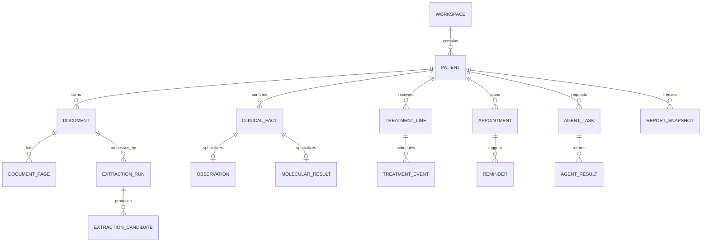

# 小胰宝 Schema 现状评估与下一步规格

日期：2026-10-14  
性质：只读评估；不代表工作台数据库已经接入或已通过产品验收。

评估依据：[SCHEMA-CANONICAL-MODEL-DRAFT.md](./SCHEMA-CANONICAL-MODEL-DRAFT.md)、[SCHEMA-SPEC.md](./SCHEMA-SPEC.md)、[DATA-SCHEMA-DESIGN.md](./DATA-SCHEMA-DESIGN.md)、[SCHEMA-FUNCTION-TRACEABILITY-DRAFT.md](./SCHEMA-FUNCTION-TRACEABILITY-DRAFT.md)、[schema/0001_initial.sql](./schema/0001_initial.sql)、[schema/read-model-contracts.md](./schema/read-model-contracts.md)。

## 1. 结论

Schema 已从“概念设计”推进到“可开始实现的 v1 基线”：规范化实体清单、首个 DDL、迁移执行器、索引方案、冻结快照契约、读模型版本规则和功能追溯矩阵已经齐备。

当前不宜直接把所有表当作最终冻结模型。下一步应先冻结四个跨模块边界：公共试验库、Agent 会话任务、周期计划关联、确认状态语义。它们决定后续是否能在不迁移患者事实的情况下持续调整 v3 前端。

## 2. 已完成的设计资产

| 层 | 当前成果 | 评估 |
| --- | --- | --- |
| 领域模型 | 工作区、患者、文档/分页/候选、临床事实、治疗、照护、营养、心理、时间线、试验、Agent、报告等实体 | 覆盖 v2 与 v3 的主要业务范围，方向正确 |
| 关系与约束 | `0001_initial.sql` 已包含 53 张表、外键、枚举 CHECK、唯一约束和查询索引 | 足以成为服务端仓储层的起点 |
| 数据血缘 | 原件 → 解析候选 → 已确认事实 → 读模型/报告快照 | 是未来每周调整页面而不重写数据层的关键 |
| 迁移 | `migrate.mjs` 记录版本与 checksum，事务执行、完整性检查、WAL checkpoint | 临时 SQLite 库已实际执行 `0001`，二次 `--check` 通过 |
| 冻结结论 | 匹配评估、报告快照的 JSON 契约与校验器 | 示例与反例校验均符合预期 |
| 前端隔离 | 16 个版本化读模型契约，界面不应直接拼 SQL | 适合 v3 后续频繁调整布局 |
| 功能覆盖 | v2 / v3 → 实体 → 读模型 → 验收用例矩阵 | 已能发现“界面缺口”与“模型缺口”的区别 |

## 3. 关键关系已经成立

这套关系可以支撑：一份报告确认出的指标同时进入看板、趋势、临床匹配和报告导出；治疗线同时进入一图秀、治疗日历和匹配档案；Agent 输出先作为候选，不会自动改写事实。

## 4. 开工前必须冻结的四项

### 4.1 公共试验数据与患者业务库

`0001_initial.sql` 目前把 `trial_record`、地点和规则放在主业务库中，并让匹配评估以外键关联它们。规范化模型同时把“公共只读试验数据是独立库还是同库分表”列为未决。

建议冻结为：**患者库 `xyb.db` 与版本化公共试验库物理分离**。患者的收藏、笔记、联系记录、查询和评估只保存稳定 `trial_key`；评估快照冻结来源 generation、规则原文和输入事实。公共库可整体更新，不应删除或改写患者历史。

这意味着首次实现前应决定：将 `trial_*` 公共表移入 `trials.db`，或明确首版暂不支持整库替换并接受同库迁移成本。推荐前者。

### 4.2 Agent 任务与 DSH 会话归属（已落地首版）

迁移 `0002_agent_cycle_links.sql` 已新增 `page_code`、`agent_role_code`、`prompt_template_id`、`prompt_rendered`、`session_ref`、`input_snapshot_hash`、`requested_by` 和结果 `summary` / `output_rel_path`。页面“给我建议”先创建本地任务，再尝试使用公开的 `ensureSession()` 与原生草稿接口。

仍待目标 Desktop 实机验证的只有会话创建、草稿填入和发送后的状态回写；结果不会自动成为患者事实。

### 4.3 周期治疗、预约与提醒（已落地关系，规则待实现）

迁移 `0002_agent_cycle_links.sql` 已为 `appointment` 和 `reminder` 新增 `related_treatment_event_id`，可精确关联某次治疗事件。化疗、血常规、肿瘤标志物、增强 CT 的周期模板、失效规则和倒计时环仍须作为后续命令/读模型实现；当前页面仅展示用户明确录入的计划事项。

### 4.4 确认状态与值状态

`clinical_fact.status` 表示候选是否已确认；`observation.status`、`molecular_result.status` 表示测量/未检测/阴性/未知。两层语义合理，但必须在命令规格中固定优先级：

- 只有 `clinical_fact.status='confirmed'` 才进入看板、趋势、匹配和正式报告；
- 专属结果状态只解释该事实的医学值状态，不能替代确认状态；
- `not_tested`、`negative`、`unknown` 和“无记录”分别显示，不能用 null 混合。

## 5. 不是阻塞项、但应列入后续迁移

| 项目 | 处理建议 |
| --- | --- |
| 中文全文检索 | FTS5 trigram 先用真实 OCR 文本验证，再单独迁移；不放入 `0001` |
| 字段级加密 | 先冻结心理和联系人等加密列清单；加密在服务层完成，不改变领域关系 |
| 扩展字段 | `field_definition` / `fact_value` 已能承接低频字段；用于筛选、趋势或规则判定的字段仍应升为正式列 |
| 报告导出 | `report_snapshot` / `export_artifact` 已覆盖 HTML/PDF/JPEG 血缘；渲染器和分页另定实现规格 |
| 读模型 | 当前 16 个 `.v1` 合理；每个契约下一步要补 JSON shape、必填性、空值语义和性能预算 |

## 6. 下一步规格开发顺序

1. **Schema Freeze v1**：公共试验库物理分离仍待完成；`0001` 已冻结，后续只新增迁移。
2. **写入命令规格**：为“导入文档、确认候选、手工录入、修订事实、记录治疗、生成预约、提交 Agent 任务、审核结果、导出报告”定义事务、幂等键、审计字段和失败恢复。
3. **读模型字段规格**：优先定义 `dashboard.summary.v1`、`records.review.v1`、`records.trends.v1`、`timeline.series.v1`、`nutrition.overview.v1`；它们覆盖 v3 最先要落地的页面。
4. **公共试验数据规格**：冻结 `trials.db` 的 generation、稳定 `trial_key`、更新/回滚和与 `xyb.db` 的只读关联方式。
5. **Agent 任务实机验证**：验证“给我建议”的 DSH 会话、草稿和结果回写；订阅日报与报告生成复用相同任务模型。
6. **测试夹具规格**：准备一位脱敏患者的文档、候选、确认、修订、缺失、手工录入和匹配快照，作为迁移、读模型、导出和 UI 的共同测试数据。

## 7. 当前状态判定

| 判定 | 结果 |
| --- | --- |
| 可以开始实现 SQLite 仓储、迁移和前四个读模型 | 是 |
| 可以开始把 v3 静态页面替换为真实服务端读写 | 是，但先冻结第 4 节四项 |
| 可以宣称临床检索/Agent/提醒已经可用 | 否，仍缺运行时和宿主接口验证 |
| 可以随意改动 `0001_initial.sql` 作为后续演进手段 | 否；应用后应只新增 `0002+` 迁移 |
