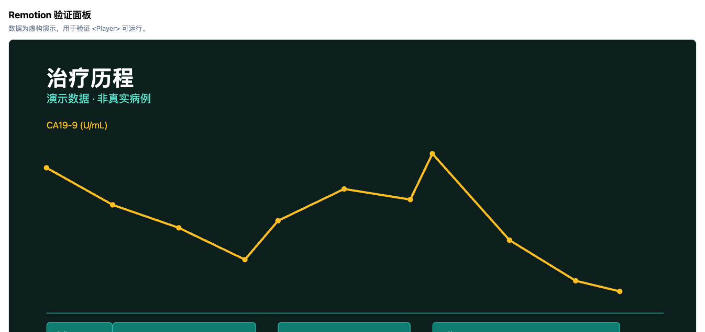
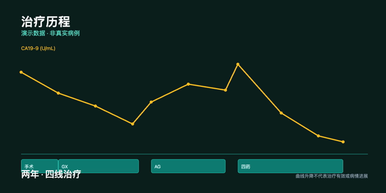

# 小胰宝工作台 · 存储、安全与数据出境规格

日期：2026-10-13 · 状态：**存储选型与启动口令已由用户确认；加密边界与原件策略已冻结。待实现验证**。

上级文档：[SPEC-v0.4.md](./SPEC-v0.4.md) §6.3。相关：[TIMELINE-SPEC.md](./TIMELINE-SPEC.md)、[INTEGRATION-DESIGN.md](./INTEGRATION-DESIGN.md)。

本文件冻结三件事：**持久层选型**、**启动口令（安全模式）**、**原件不入库**。另有两条已确认的用户决策记录在 §5（Remotion 用途）与 §6（数据出境原则）。

---

## 1. 结论摘要

| 决策 | 结论 | 依据 |
|---|---|---|
| 持久层 | **`node:sqlite`（Node 内置），不用 `better-sqlite3`** | §2 本机实测 |
| 数据库加密 | **不做整库加密**；改用启动口令 + 字段级加密 | §3；§3.1 实测无加密能力 |
| 启动口令 | **做**。访问控制语义，**不是加密**，忘记可恢复 | §3.2 |
| 敏感字段 | **按列加密**（AES-256-GCM），仅限明确列出的列 | §3.3 |
| 病历原件 | **不进 SQLite**，作为普通文件保存在 `documents/` | §4 |
| Remotion | 仅用于「病情故事」视频导出，**不用于看板交互** | §5 |
| 数据出境 | **永不自动上传**；分享必须用户逐条确认并主动导出 | §6 |

**一句话**：数据库是明文的，保护来自操作系统全盘加密 + 应用层口令；原件是明文文件。这两点必须对用户如实说明，不得宣称「数据库已加密」（沿用 v0.3 §6.2 的措辞约束）。

---

## 2. 持久层选型：`node:sqlite`

### 2.1 为什么不是 `better-sqlite3`

`better-sqlite3` 是原生模块，需要按 OS/架构/运行时 ABI 分别编译或预编译，工作台分发时必须为每个目标平台携带正确的二进制。这与 [INTEGRATION-DESIGN.md](./INTEGRATION-DESIGN.md) §2.1 为 CTV 记录的原生依赖属于同一类负担，而**存储是本工作台的核心链路，不应引入这种负担**。

### 2.2 实测证据（本机，已执行）

用**实际安装的 DSH Desktop 运行时**（非开发机 Node）探测：

```
ELECTRON_RUN_AS_NODE=1 "/Volumes/DSH Desktop 0.11.1-arm64/DSH Desktop.app/Contents/MacOS/DSH Desktop" <probe>
```

结果：

| 项 | 实测值 |
|---|---|
| Electron | `43.0.0` |
| Node | `24.17.0` |
| NODE_MODULE_VERSION | `148` |
| `node:sqlite` 可用 | ✅ `DatabaseSync` 可导入并读写 |
| 事务 | ✅ `BEGIN` / `ROLLBACK` 正常 |
| `sqlite_version()` | `3.53.0` |
| WAL | ✅ 文件库 `PRAGMA journal_mode = WAL` 生效 |
| FTS5 | ✅ `CREATE VIRTUAL TABLE ... USING fts5` 成功 |
| JSON1 | ✅ `json_extract` 可用 |
| 外键 | ✅ `PRAGMA foreign_keys = ON` 生效 |

**结论**：存储层零原生依赖，不需要为 macOS arm64 / macOS x64 / Windows x64 分别打包。

**边界**：以上仅在 macOS arm64（本机安装版）实测。**Windows 与 macOS x64 未实测**，落包前须在目标平台重跑同一探测（可复用 `scripts/probe-electron-node-runtime.mjs` 的启动方式）。`node:sqlite` 在 Node 22.5+ 引入且长期标注实验性，**宿主 Node 主版本变化后须复测**，不能把本次结论当成跨版本承诺。

### 2.3 业务根布局

在 v0.3 §6.2「用户明确选择的业务根」基础上收敛为：

```text
<用户选择的资料根>/
  xyb-store.json                 # storeId、格式版本；不含密钥、不含口令材料
  xyb.db                         # SQLite：结构化数据 + FTS5 索引
  xyb.db-wal / xyb.db-shm        # WAL 附属文件（运行期存在）
  patients/<patientId>/
    documents/<documentId>/      # 原件副本（不进数据库，见 §4）
    derived/                     # 本地文本、候选结果、证据定位
    summaries/                   # 汇总历史版本
    exports/                     # 用户导出的 CSV / 视频
  backups/                       # 用户主动执行的备份
```

**单库 + 单根**：数据库放在业务根顶层而不是 `patients/` 下，因为治疗线数、匹配规则、看板快照需要跨患者一致性约束（见 §2.4）。多患者场景下以 `patientId` 外键隔离，**不按患者分库**。

**备份完整性硬要求**：`xyb.db`、`-wal`、`-shm` 与 `patients/**/documents/` 必须**同根、同时备份**。备份必须先在 WAL checkpoint 后取一致性快照。**不允许出现「备份了数据库但丢原件」或反之**——这是医疗数据不可接受的失败模式，写入 §7 验收。

### 2.4 数据库层强制的约束

以下约束由 schema 保证，不依赖应用层自觉：

| 约束 | 实现 |
|---|---|
| `TreatmentLine` 唯一权威 | 看板、一图秀、匹配均读同一表；不建冗余副本 |
| 档案变更使旧评估失效 | `MatchAssessment` 存生成时 `revision`；不静默重算 |
| 可编辑实体版本 | 带 `revision` 列，沿用 SPEC-v0.4 §6.2 |
| 跨表一致性 | 外键 + 事务（实测均可用） |

**这是选 SQLite 而非 JSON 文件的核心理由**：`TreatmentLine` 三处同步、`revision` 失效传播这类约束，用 JSON 需要手工实现并发控制与失效逻辑，是 bug 高发区；用 SQL 是声明式的。

### 2.5 职责边界

工作台客户端是浏览器环境（`dsh.client.platform: "web"`），**拿不到 SQLite**。所有读写经服务端入口 `/api/xyb-workbench/...`。服务端**不信任**客户端传入的 `patientId` 与路径，须校验：store 已选择、患者属于该 store、document 属于该 patient。沿用 [INTEGRATION-DESIGN.md](./INTEGRATION-DESIGN.md) §7.2 的边界规则。

中文全文检索需注意 FTS5 默认分词器对中文无效，**须配置 trigram 分词器或改用其它方案**——此项未实测，列入 §7 待验证。

---

## 3. 安全模式：启动口令

### 3.1 先明确：为什么不做整库加密

对**实际安装的运行时**探测加密能力：

```
PRAGMA cipher_version  →  empty      （空 = 未编译加密库）
PRAGMA key             →  empty      （静默无效，不报错）
PRAGMA rekey           →  empty
PRAGMA hexkey          →  empty
compile_options        →  无 SQLCIPHER / SEE 项
```

`PRAGMA key` **不报错但也不生效**——这是最危险的情形，会让人误以为已加密而实际是明文。内置 `node:sqlite` 是标准构建，**不具备加密能力**。

要真加密只有两条路，均不采用：

| 路径 | 不采用的理由 |
|---|---|
| `better-sqlite3-multiple-ciphers` | 把 §2.2 刚消除的原生编译负担请回来 |
| 自研整库加密 | 工作量大、易错，且破坏「数据可携带」承诺 |

**用户决策**：采用安全模式（启动口令），不做整库加密。

### 3.2 启动口令的语义（必须对用户说清）

**它是访问控制，不是加密。**

| 事实 | 说明 |
|---|---|
| 数据库本身是明文 | 用任何 SQLite 工具可直接打开 `xyb.db` |
| 口令防的是「顺手打开看看」 | 借人电脑、家人使用等场景 |
| **忘记口令可恢复** | 因为是访问控制，不是密钥派生加密。这是它优于真加密之处 |
| 不防已在运行的恶意软件 | 能读进程内存者基本无效 |
| 不替代系统全盘加密 | FileVault / BitLocker 是第一道防线，本口令是第二道 |

**实现**（本机已实测）：

| 项 | 方案 | 实测 |
|---|---|---|
| 口令派生 | `scrypt`，`N=32768, r=8, p=1`，16 字节随机 salt | ✅ 单次派生约 115ms |
| 校验 | `timingSafeEqual` 常数时间比较 | ✅ 正确口令 `true`、错误口令 `false` |
| 存储 | 仅存 salt + 派生值，**不存口令本身** | — |
| 失效 | 连续失败递增延迟，不锁定数据（防拒绝服务） | 待实现 |

`N=32768` 下 115ms 对交互合适；若目标机器更慢，可下调 `N` 但**不得低于 `2^14`**。

### 3.3 字段级加密（仅限敏感列）

对确有更高保护需要的列（**心理评估数据是首要候选**，因其已定为不进 AI 上下文，见 SPEC-v0.4 §7.6），采用按列加密：

- 算法：`AES-256-GCM`，12 字节随机 IV，16 字节认证标签
- 密钥：由宿主密钥管理或系统钥匙串保存，**不由启动口令派生**（保证忘记口令仍可恢复）
- 实测：本机往返正常，篡改密文被 `REJECTED`

**待用户确认加密列清单**（§7）。**未列入清单的列一律不加密**，以保住导出与迁移能力。

**风险须知**：字段级密钥丢失 = 该列数据永久不可读。须在用户启用时显式说明，并提供密钥备份流程（待设计）。

---

## 4. 原件不进 SQLite

**决策**：病历原件、CT/病理图片、PDF 等以**普通文件**存放于 `patients/<patientId>/documents/<documentId>/`，数据库中只存元数据、`contentHash`、相对路径与证据定位。

理由：

| 理由 | 说明 |
|---|---|
| 避免 BLOB 膨胀 | 单份扫描件数 MB，入库会显著放大数据库体积与备份成本 |
| 用户需能直接打开 | 原件要能用系统默认程序打开、单独发送给医生 |
| 备份粒度 | 原件可单独备份/迁移，与结构化数据解耦 |
| **安全一致性** | **重要**：原件是明文文件。数据库即便将来加密，原件仍是明文——**用户必须知道这一点**，否则会产生「我加密了所以都安全」的错误认知 |

**引用规则**：文件以受控 token/ID + 相对路径引用，**不允许客户端传入任意绝对路径**。路径解析须检查规范化路径、符号链接与父目录边界，不跟随符号链接越过业务根（沿用 [INTEGRATION-DESIGN.md](./INTEGRATION-DESIGN.md) §7.2）。

**文件夹命名**：以 `documentId` 为主键目录名，**不用患者昵称或文件名**作为路径主键（沿用 v0.3 §6.2）。

---

## 5. Remotion：用途决策

用户已确认受众为**自己 + 病友群**，License 主体为**公益组织**。

| 项 | 结论 |
|---|---|
| License | 非营利组织属免费许可覆盖范围，**无预算、无渲染费**；Codec（H.264/AAC）专利费不在 Remotion 许可内，须独立评估 |
| 用途 | **仅「病情故事」视频导出**，置于 `7 全程管理`，**不放进一图秀** |
| 不用于 | 看板交互、图表交互——那些用 ECharts（见 TIMELINE-SPEC） |
| 理由 | 一图秀服务「患者自己细看」；视频服务「讲给别人听」。**两个受众、两个认知任务**，混在一起会同时损害两边 |

**视觉原则**：视频是**叙事**不是图表动画。每句文案必须来自用户已确认的记录，**不出现自动医学解读**（沿用 SPEC-v0.4 §7.1、TIMELINE-SPEC §4.3）。视频不得使用「方案有效」「病情好转」等结论性措辞。

**技术验证已完成（2026-10-13，两轮）**：预览与导出均已跑通，详见 §5.1 与 §5.2。

| 能力 | 结论 | 体积 |
|---|---|---|
| `<Player>` 预览播放 | ✅ 已在浏览器实测通过 | 355.6 KiB / gzip 112.0 KiB |
| **导出 MP4** | ✅ **已产出可播放的 358 KB H.264 MP4** | 881.7 KiB / gzip 255.7 KiB |
| 两者同时打包 | ✅ 共用代码，小于相加 | 938.1 KiB / gzip 273.6 KiB |

**必须知情的强制遥测（§5.2 实测确认）**：浏览器端导出在渲染时**必定向 `https://www.remotion.pro/api/track/register-usage-point` 发起一次 POST**，无法关闭。**该请求本身不携带患者数据**（未发送画面内容或输入数据），但它是**每次导出都会发生的对外网络连接**。对强调「数据不出本机」的公益医疗工作台，这必须在产品说明中如实披露，或改为仅提供预览、导出走用户手动截图/录制。

浏览器端渲染需 WebCodecs（实测 Chromium 环境 avc/vp8/vp9/av1 全部可用）。

### 5.1 Remotion 验证包实测记录

**验证目标**：确认 `@remotion/player` 能被装入工作台客户端「已构建单文件模块」并实际渲染，同时测量体积。这是 §5 的技术前置。



*上图为验证包在浏览器中的实际渲染结果：治疗历程标题、CA19-9 趋势曲线（逐帧绘制）、方案色块与中性免责说明。数据为虚构演示。*

**验证对象**：一段虚构的治疗史叙事动画（治疗历程 + CA19-9 趋势曲线 + 方案色块 + 中性免责说明），使用 `useCurrentFrame()` 驱动分镜节奏，数据结构模拟 `TreatmentLine` 与 `Observation` 的关系。

| 检查项 | 结果 |
|---|---|
| 依赖安装（隔离临时目录） | ✅ `@remotion/player@4.0.535` + `remotion@4.0.535` + React 19 |
| 打包为单文件模块 | ✅ 符合 `window.__ModuleLoader__.load({ id, factory })` 契约 |
| **客户端 bundle 体积** | **355.6 KiB（364,165 bytes）；gzip 112.0 KiB** |
| 体积主要来源 | `remotion` 252.6 KiB + `@remotion/player` 60.9 KiB + `no-react` 40.0 KiB |
| React 保持外部依赖 | ✅ 未内联，符合规范 3.5「require 只能拿共享基线」 |
| 无静态 `import` / `import.meta` | ✅ |
| 无远程 fetch / CDN 依赖 | ✅ 包内 URL 全部是错误提示文案中的静态链接 |
| **浏览器实际渲染** | ✅ **`READY`，零运行时错误** |
| 播放器挂载与控制条 | ✅ 时间显示 `0:10 / 0:18`，可播放 |
| 动画逐帧推进 | ✅ 捕获到叙事字幕随帧变化，SVG 曲线渐变绘制 |

**已排除的风险**：包体积不是阻塞项（gzip 112 KiB 对桌面应用可接受）；`<Player>` 不需要宿主额外能力；打包链路可复用工作台既有单文件构建方式。

**尚未验证（不得据本次结果推断）**：

- [ ] 在**真实工作台宿主**内加载（本次是在独立浏览器页中模拟模块加载器契约，非 DSH Desktop 内实测）
- [ ] Electron 渲染进程中行为与纯 Chrome 的差异
- [ ] 与宿主 React 版本一致性的长期兼容（本次用 React 19.2.0）

**验证环境**：macOS arm64；打包用 esbuild 0.25.0（`format=cjs, target=chrome120, external=react`）；浏览器验证经 `agent-browser`（Chrome/CDP）加载本地静态页。**验证脚本位于临时目录，未写入仓库**，结论与复现方法以本节记录为准。

### 5.2 视频导出（MP4）实测记录

**验证目标**：确认能否导出**可分享给病友群的视频文件**（而非仅预览），并核实强制遥测的实际行为。这是 §5「受众含病友群」成立的前提。



*上图为**从导出的 MP4 文件中**用 ffmpeg 抽出的第 520 帧（共 560 帧）：四条治疗线色块、完整 CA19-9 曲线、末段字幕与中性免责说明均正确。*

**产出物**：[assets/remotion-export-sample.mp4](./assets/remotion-export-sample.mp4)（358,825 bytes，可播放）

| 检查项 | 结果 |
|---|---|
| WebCodecs 可用 | ✅ `VideoEncoder` / `AudioEncoder` 均存在，`isSecureContext` 为真 |
| 编码器支持 | ✅ `avc` / `vp8` / `vp9` / `av1` **全部返回 supported** |
| **导出成功** | ✅ `renderMediaOnWeb({ container:'mp4', videoCodec:'h264' })` |
| **产物** | ✅ **358,825 bytes，`video/mp4`**，耗时 **3,304 ms** |
| 容器与编码（ffprobe） | ✅ `h264`，1280×640，30fps，**560 帧**，时长 18.67s |
| 帧数完整性 | ✅ 560 帧全部编码，与 `durationInFrames` 一致 |
| 画面内容正确 | ✅ 抽帧确认时间轴、曲线、字幕、免责说明均随帧演进 |
| 进度回调 | ✅ 收到 14 次进度更新（0→100） |
| **强制遥测** | ⚠️ **确认：向 `https://www.remotion.pro/api/track/register-usage-point` 发出 1 次 fetch，无法关闭** |
| 遥测是否含患者数据 | ✅ **未观察到**：该请求未携带画面内容或 `inputProps` |
| 控制台错误 | ✅ 无 |

**包体积的关键发现**：直接打包导出能力为 **2498.6 KiB**，其中 **1,628 KiB（约 65%）是三个音频编码器**（`@mediabunny/aac-encoder` 969K、`flac-encoder` 315K、`mp3-encoder` 304K）。本组合**无音频**，将这些包 stub 掉后降至 **881.7 KiB（gzip 255.7 KiB）**，**节省 1.6 MB**。**正式实现若全程无音频，应采用同样的排除策略**；若将来加入配音，须重新评估并恢复对应编码器。

| 方案 | 原始 | gzip |
|---|---:|---:|
| 仅 `<Player>` 预览 | 355.6 KiB | 112.0 KiB |
| 仅导出（含音频编码器） | 2498.6 KiB | — |
| **仅导出（排除音频编码器）** | **881.7 KiB** | **255.7 KiB** |
| **预览 + 导出（排除音频编码器）** | **938.1 KiB** | **273.6 KiB** |

**尚未验证**：

- [ ] 在**真实工作台宿主**内导出（本次为独立浏览器页）
- [ ] Electron 渲染进程内 WebCodecs 可用性（**这是最大的剩余风险：Electron 的编码器支持可能与 Chrome 不同**）
- [ ] Safari / WebKit 环境（Safari 需 26+）
- [ ] 长视频导出（本次仅 18.7 秒 / 560 帧）的内存与耗时表现
- [ ] 离线环境下遥测请求失败时是否阻塞导出
- [ ] 音频轨必要性（本组合导出的 MP4 含一条 AAC 空音轨，需确认是否可去除）

**验证方法**：导出后经页面 `arrayBuffer → base64` 取回本地，用 `ffprobe` 校验容器与帧数，再用 `ffmpeg` 抽帧目视核对内容。**未使用任何 Remotion 服务端渲染或 FFmpeg 渲染路径**，全部为浏览器端 WebCodecs 编码。

---

## 6. 数据出境原则（新增硬约束）

受众含病友群，意味着存在数据离开本机的路径。**治疗史视频本身高度可识别**：发病时间 + 方案序列 + 指标走势的组合接近唯一，脱敏难以彻底。

| 规则 | 内容 |
|---|---|
| **永不自动上传** | 任何云同步、自动分享、遥测携带病历内容一律禁止 |
| **用户主动导出** | 分享 = 用户在本机生成文件，再自行决定去向 |
| **逐条确认** | 导出含患者数据的文件前，须显式说明文件去向与内容范围 |
| **视频导出同规** | 病情故事视频适用同一规则；导出前提示「该视频包含可识别信息」 |
| **心理数据** | 沿用既有规则：不进 AI 上下文；**同样不进视频导出** |

与 SPEC-v0.4 §8「另议」一致：云同步、多角色协作不进入本轮，**不因宿主具备能力就默认开放患者资料**。

---

## 7. 待确认与待验证

**待用户确认**

- [ ] 字段级加密的**列清单**（建议：心理评估结果、哀伤/安宁疗护记录；其余不加密）
- [ ] 启动口令是否默认开启，还是用户可选
- [ ] 口令忘记后的恢复流程（建议：仅重置口令，不动数据）
- [ ] 字段级密钥丢失时的处理与告知方式

**待实测（不得以本机 macOS 结果替代）**

- [ ] Windows x64 与 macOS x64 上 `node:sqlite` 可用性
- [ ] 宿主 Node 主版本升级后的复测（`node:sqlite` 为实验性 API）
- [ ] FTS5 中文分词（trigram）实际检索效果
- [ ] WAL 在 Windows 文件锁语义下的行为
- [ ] 卸载工作台后 `xyb.db` 与 `documents/` 均保留（规范第 11 条硬要求）
- [ ] 备份一致性快照：确认不出现「有库无原件」或「有原件无库」
- [x] ~~Remotion `<Player>` 在工作台客户端单文件 bundle 中可运行~~ → ✅ 已验证，见 §5.1
- [x] ~~体积测量：加入 Remotion 后的客户端 bundle 实际大小~~ → ✅ 355.6 KiB / gzip 112.0 KiB，见 §5.1
- [ ] Remotion 在**真实工作台宿主**内加载（§5.1 仅为模拟模块加载器契约）
- [ ] Remotion 视频导出（`renderMediaOnWeb`）与 WebCodecs 可用性
- [ ] `node:sqlite` 与 Remotion 同时加入后的客户端/服务端总体积

---

## 8. 验收要点（新增）

| 场景 | 必须观察到 |
|---|---|
| 数据库可被外部工具打开 | 如实成立，且产品文案**不宣称数据库已加密** |
| 忘记口令 | 可重置口令并恢复全部数据 |
| 错误口令 | 拒绝进入业务面板，给出可重试状态，不损坏数据 |
| 原件独立可用 | 不启动工作台时，原件可用系统程序直接打开 |
| 备份完整性 | 备份产物同时含数据库与原件，恢复后两者均可读 |
| 敏感列 | 用 SQLite 工具直接查看时为密文；工作台内经授权可正常显示 |
| 篡改检测 | 手工修改敏感列密文后，读取报错而非返回错误明文 |
| 数据出境 | 无任何自动上传；导出前有去向说明 |
| 视频导出 | 不含自动医学解读，且导出前提示可识别信息 |
| 卸载保留 | 卸载工作台后数据库与原件均在原位置 |

---

## 9. 本次实测记录（可复现）

探测方法：以 `ELECTRON_RUN_AS_NODE=1` 直接运行**已安装的 DSH Desktop 二进制**（`/Volumes/DSH Desktop 0.11.1-arm64/DSH Desktop.app/Contents/MacOS/DSH Desktop`），执行临时脚本。**未修改任何应用文件、未安装依赖、未使用开发机 Node 替代宿主运行时。**

| 探测 | 结果 |
|---|---|
| `node:sqlite` 导入与读写 | ✅ |
| 事务 / WAL / 外键 / FTS5 / JSON1 | ✅ |
| `PRAGMA cipher_version` / `key` / `rekey` | 空（无加密能力） |
| `scrypt` 派生与常数时间校验 | ✅ 115ms，正误口令判定正确 |
| `AES-256-GCM` 往返与篡改拒绝 | ✅ 往返正确、篡改 `REJECTED` |

**证据边界**：以上均为**运行时能力探测**，**不等于**工作台已实现持久层、已实现启动口令或已通过验收。实现与集成后的验收见 §8，未实测项见 §7。

---

## 10. 时间轴节点化输入与输出目录

工作台把每一次输入和每一份输出都绑定到一个时间轴节点，便于按检查、治疗、症状、营养、心理、试验查询等类别回看并让 Agent 使用。

```text
<业务根>/patients/<patientId>/
  input/<timelineNodeId>/<category>/
    manifest.json                 # 记录输入类型、时间、来源、相对路径、确认状态
    <原始文件或手工录入附件>
  output/<timelineNodeId>/<category>/
    manifest.json                 # 任务、Agent 会话、输入版本、生成时间、状态
    <结果文件：md / json / html / pdf / jpeg>
```

- `timelineNodeId` 是稳定 ID，不用患者姓名、诊断或文件名作为目录名。
- `category` 使用受控值，例如 `lab`、`imaging`、`pathology`、`treatment`、`nutrition`、`symptom`、`trial-query`、`report-export`。
- 新增输入时，界面先选择或新建时间轴节点与类别，再选文件或填写记录；Agent 只能读取用户选中的、已确认或明确许可的输入清单。
- 输出写入 `output/` 后必须有 manifest，记录生成任务、使用的输入清单、数据集版本与可复现提示词。输出不自动写回病历事实。
- 路径只由服务端根据 `patientId`、节点 ID、类别和文件 ID 生成；客户端不得拼接绝对路径。
