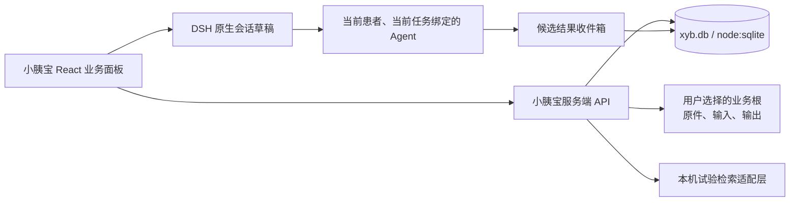

# 小胰宝工作台 v3 · 实现能力评估报告

日期：2026-10-14  
状态：**实施评估，非已实现能力声明**。评估对象是 `prototype-v3.html` 与现有规格；没有构建、打包、安装或修改业务实现。

相关设计：[SPEC-v0.4.md](./SPEC-v0.4.md)、[SCHEMA-SPEC.md](./SCHEMA-SPEC.md)、[STORAGE-SPEC.md](./STORAGE-SPEC.md)、[INTEGRATION-DESIGN.md](./INTEGRATION-DESIGN.md)、[AGENT-QUERY-DESIGN.md](./AGENT-QUERY-DESIGN.md)。宿主规范依据本机 DSH Desktop 附带的《[工作台开发规范](./workbench-standard.zh.md)》。

## 1. 结论

**v3 的页面内容可以完整做成一个本地优先的轻量业务系统。** DSH 工作台并不限制业务表单、SQLite、时间线、图表、文件索引、规则计算、离线数据检索或本机任务调度；它限制的是宿主导航、会话归属、前端特权、目录创建方式和 Agent 交接方式。

本项目不应把 `prototype-v3.html` 直接塞进插件作为最终产品。应把它作为视觉和交互验收基线，实施为：

第一版可以完成全部七个一级 Tab 的“查看、录入、核对、保存、导出、调用 Agent 建议”闭环。真正依赖外部能力的部分需要按来源逐项验收，不能与页面完成度混为一谈。

## 2. 页面能力评估

| 页面 | 可完整实现的本机能力 | 依赖或实施重点 | 当前框架限制 / 不能承诺项 |
| --- | --- | --- | --- |
| 看板 | 8 维度汇总、变化提醒、未来两周日历、周期环、患者切换、跳转、导出入口 | SQL 读模型和每个事实的来源/确认状态 | 不能把规则提醒显示为诊断或自动治疗决定；桌面通知需另核实公开 API |
| 病情整理 | 文档索引、原件查看、解析候选、逐项确认、跨页比对、病情汇总 | 文件导入、提取器适配、字段版本和证据定位 | OCR/PDF/Word 的识别准确率不由 DSH 保证；原始文件不能交给前端任意路径读取 |
| 病情一图秀 | 多指标选择、独立纵轴、治疗/检查时间线、筛选、导出 PNG/HTML/PDF | ECharts、时间事件读模型、导出渲染 | 不能把不同单位或未确认数值自动连线；视频导出属于后续附件能力 |
| 临床匹配 | 基因/IHC 档案、规则分组、离线检索、收藏、订阅、日报、候选回写 | 规则库、统一检索服务、数据版本和任务调度 | 不能宣称实时招募、保证可入组或替代研究中心确认；每个外部来源须单独验收 |
| 营养管理 | 体重/BMI/能量趋势、PG-SGA 表单、PEI 与制剂使用记录、周期与待办 | 观察值与餐次记录表、公式版本 | 不能变成自动营养处方；没有真实连续记录时不能生成趋势结论 |
| 心理支持 | 量表录入与趋势、资源目录、安宁疗护与哀伤信息、用户主动发起的建议 | 敏感字段分级、资源数据版本 | 心理自由文本默认不带入 Agent；危机处置不应由本地工作台单独承担 |
| 全程管理 | 毒性、并发症、带管、血管通路、治疗日历、提醒清单和详情记录 | 事件表、状态流转、和治疗线的关联 | 自动系统通知、医院预约联动、设备数据同步均不属于当前规范已确认能力 |

### 2.1 “给我建议”入口

此功能适合实现，而且应保留页面角色。页面角色决定选择哪些事实、怎样组织输出，不能改变 Agent 的医学边界。

- 看板：胰腺癌病程管家；组织变化、计划和复诊准备。
- 病情整理：病历整理与就诊准备助手；组织缺口、核对顺序和问题清单。
- 病情一图秀：病程时间线解读助手；组织时间节点与待补记录。
- 临床匹配：临床试验线索助手；组织候选线索、条件缺口和研究中心确认项。
- 营养：肿瘤营养记录助手；组织体重、摄入、评估和沟通问题。
- 心理：心理支持陪伴助手；只处理用户明确选择共享的内容。
- 全程管理：治疗与照护计划助手；组织待办、记录和复诊沟通事项。

实现时按钮不能自行调用或模拟聊天界面。它应创建或恢复当前工作台归属的原生会话，将**可编辑的结构化提示词填入草稿**，由用户发送。Agent 输出先进入 `agent_output` 候选收件箱，用户逐项确认后才写入患者事实或计划。

## 3. SQLite 与轻量业务系统

SQLite 是本项目的合适方案，且已有本机运行时验证基础。现有 [STORAGE-SPEC.md](./STORAGE-SPEC.md) 记录：本机安装的 DSH Desktop Electron Node 可使用 `node:sqlite` 的 `DatabaseSync`，并已验证事务、WAL、外键、FTS5 与 JSON1。它避免为核心病历库引入 `better-sqlite3` 的原生 ABI 打包负担。

### 3.1 推荐边界

- 客户端只渲染 React 界面和调用 `/api/xyb-workbench/*`，不直接接触 SQLite、`fs`、子进程或模型凭据。
- 服务端是唯一的 `node:sqlite` 访问方：开启 `foreign_keys`、使用短事务、以迁移版本升级数据库。
- 原件放在用户选择的业务根 `patients/<patientId>/documents/<documentId>/`；SQLite 保存相对路径、哈希、元数据和证据定位，不存文件 BLOB。
- 同一个业务根使用单库 `xyb.db`；每张患者相关表都有 `patient_id` 外键。治疗线、分子检测、观察值、日历事件只保留一份权威事实，所有 Tab 读同一事实源。
- 输出、导入和 Agent 任务按时间节点落在 `input/`、`output/` 和数据表索引中；导出文件与原始资料均可回溯。

### 3.2 首批表与读模型

已有 `schema/0001_initial.sql`、迁移和契约草案可作为起点。首批落地应先覆盖：`patient`、`document`、`fact_revision`、`observation`、`genomic_alteration`、`treatment_line`、`timeline_event`、`care_record`、`task/reminder`、`trial_query`、`match_assessment`、`agent_task`、`agent_output`、`file_artifact`。

看板、周期卡、指标趋势和病情一图秀应从 SQL 视图或服务端查询构造只读模型，不能各自维护一份前端状态。编辑事实后增加患者资料 `revision`；既有匹配评估和 Agent 建议记录生成时的 revision，资料变化后显示“需要重新核对”，不静默覆盖。

## 4. 从已安装“门店选址工作台”得到的实施启发

本机已读取已安装包 `dsh-site-selection 1.2.2` 的 `package.json`、`cordis.patch.yml` 与 README。它不是医疗实现范例，但工作台集成方式可直接借鉴。

| 已验证做法 | 小胰宝的采用方式 |
| --- | --- |
| 业务面板与 DSH 原生会话并列；业务本身可在没有会话时浏览和编辑 | 患者档案、趋势、资料核对、日历和本机检索均可无会话使用 |
| 新建业务项目时由 Desktop 建立归属会话，已有项目不会无故新建会话 | 只有点击“给我建议”“交给 Agent”时才创建/恢复小胰宝会话 |
| 向 Agent 追加上下文到原生草稿，保留用户原文且不自动发送 | “给我建议”先展示可编辑摘要，再写入草稿并由用户发送 |
| 项目选择和会话映射分开保存；已有会话的明确映射优先 | `patientId ↔ workbenchSessionId` 独立表或映射文件；不同会话可指向同一患者 |
| 业务 API 与 iframe 静态资源走宿主 connection 校验；写操作要求同源 JSON | 小胰宝 API 也需要同源校验、患者归属校验和路径边界校验 |
| 删除项目入回收站，卸载工作台不清除业务资料 | 患者、文档、导出和数据库不随卸载删除；删除走可恢复策略 |

该选址包本身没有为小胰宝验证 SQLite 业务库，因此 SQLite 结论来自本项目实际 DSH Electron Node 探测，而非从该包推断。

## 5. DSH 规范适配清单

| 规范要求 | 小胰宝实施结论 | 目前状态 |
| --- | --- | --- |
| 一个 npm 包、一个工作台 | 建议仓库 `xyb-openharness-dsh-plugins/xyb-workbench` 对应一个插件包 | 待建包 |
| `package.json` 的 dsh bundle/client 声明 | `dsh.bundle.patch`、web client、`dsh-desktop-workbenches` 注入、服务端/客户端 exports 都必须具备 | 待建包 |
| `cordis.patch.yml` | 插入小胰宝自己的服务端入口，配置数据根服务目录；不覆盖其他插件 | 待建包 |
| `desktopWorkbenches.register()` | 注册一个 `customFrame` 业务面板，使用规范 GitHub repository URL，不使用旧 `id` | 待实现并以目标版验收 |
| 宿主边界 | 业务 UI 不遮挡侧栏、市场、设置和模式切换；原生 conversation 节点由宿主提供 | 页面改造时落实 |
| 无会话可用 | 本机档案和所有非 Agent 操作先可用 | 架构已明确，待实现 |
| 目录选择 | 首次选择患者资料根时调用宿主选择器；取消不能留下文件或空会话 | 公开 API 签名待目标版核实 |
| Agent 交接 | 校验会话归属，填草稿并让用户发送；不模拟私有 DOM 或自动发送 | 待核实公开接口并实现 |
| 本地安装和自测 | 用 `pnpm pack` 产物安装；在已安装列表、左侧入口和实际业务流分别验收 | 尚未开始 |

## 6. 需要列为“未满足或待核实”的内容

以下并非产品不能做，而是不能在未做目标版本验证前写成“已可用”。

1. **DSH 会话公开 API 的具体签名**：目录选择、创建/恢复工作台会话、草稿写入与 conversation 节点装配均需以目标安装版源码和真实 UI 核实。可以按选址工作台的模式设计，不能猜测私有接口。
2. **Agent/技能/MCP 自动装配**：把 `SKILL.md`、MCP 源码或数据放进包不等于 Harness 会发现它。需要明确的注册、作用域、生命周期和卸载证据。
3. **外部试验来源的运行闭包**：ChiCTR SQLite 与 XYB JSON 最适合先做；CTV 仍有 `better-sqlite3` ABI 和数据库路径验证；ICTRP 需要 Python sidecar；在线 ChiCTR 依赖浏览器相关组件。不能把四类来源都承诺为首版离线即用。
4. **资料提取质量**：PDF、扫描件、Word、影像报告的解析应只产生候选字段。准确率、页码定位和跨页比对需用脱敏样例实测。
5. **PDF/JPEG/HTML 导出**：HTML 可先完成；PDF/JPEG 需选定渲染路径并在 macOS/Windows验证字体、中文和分页。不能只靠前端截图称为正式病情报告。
6. **后台 cron 与提醒通知**：可在服务端实现可恢复的本机任务表和“打开工作台后的待办提醒”。跨应用系统通知、后台常驻、睡眠唤醒后补跑和医院预约联动不属于规范已经确认的工作台能力，需要另做宿主及平台验证。
7. **跨平台承诺**：`node:sqlite` 在本机 macOS arm64 已测；macOS x64、Windows x64 仍要重跑运行时探测、文件锁、迁移、导出与检索附件测试。
8. **文件安全与备份**：原件和 SQLite 都需要在用户确认的资料根保存；备份必须连同 `xyb.db`、WAL/SHM、原件和输出目录做一致性快照。字段级加密的密钥管理仍需最终决定。

## 7. 推荐实施顺序

1. **包与壳**：建立 DSH 包、服务端 API、React customFrame、患者选择与资料根选择；完成最小本地安装验证。
2. **事实库**：执行 SQLite 迁移，实现患者、文档、观察值、基因/IHC、治疗线、时间事件和来源定位；先完成一条“录入 → 确认 → 看板/趋势同步”的闭环。
3. **七页读模型与录入**：把 v3 视觉落入 React 组件，优先看板、病情整理、一图秀、营养和全程管理；心理字段独立授权范围。
4. **文件与导出**：实现受控导入、原件打开、候选核对、HTML 导出，再验证 PDF/JPEG。
5. **临床匹配离线 MVP**：接入 ChiCTR SQLite 与 XYB JSON，完成来源版本、检索、收藏、规则初筛和结果快照；随后逐个加入其他来源。
6. **Agent 协作**：核实目标版会话接缝，按页面角色生成可编辑草稿，建立任务/输出候选收件箱与用户确认回写。
7. **计划任务与跨平台**：实现订阅任务、恢复和失败显示；最后验证 macOS x64/Windows x64 与完整本地自测清单。

## 8. 开工门槛

可以开始实现。开始前只需冻结以下工程决策：

- 首发目标为 macOS arm64，Windows x64 作为后续独立验收目标；
- 包名、SemVer、业务根选择文案和首个 SQLite 迁移版本；
- 首发离线来源为 ChiCTR SQLite + XYB CDE JSON，其他来源不阻塞核心闭环；
- 使用目标 DSH Desktop 版本实际核实目录选择、会话创建和草稿写入的公开接缝；
- 至少准备脱敏的 CT、检验、病理/基因、治疗记录样例，用于抽取与核对验收。

满足这些条件后，工作台能以“业务流程约束 + SQLite 单一事实源 + 本机文件资产 + 受控 Agent 交接”的方式稳定演进，支持后续每周调整前端而不重写数据层。
